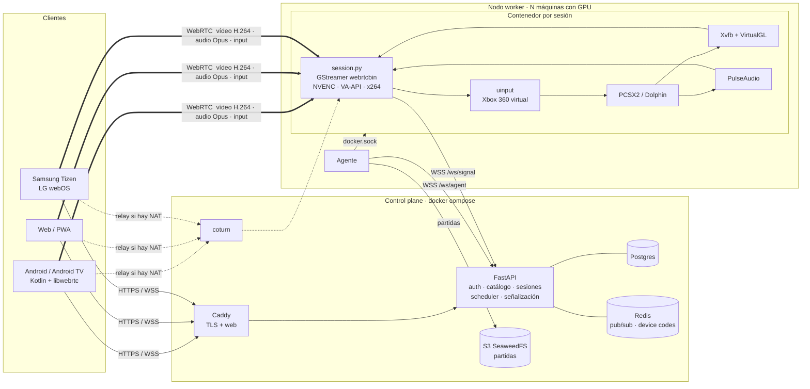
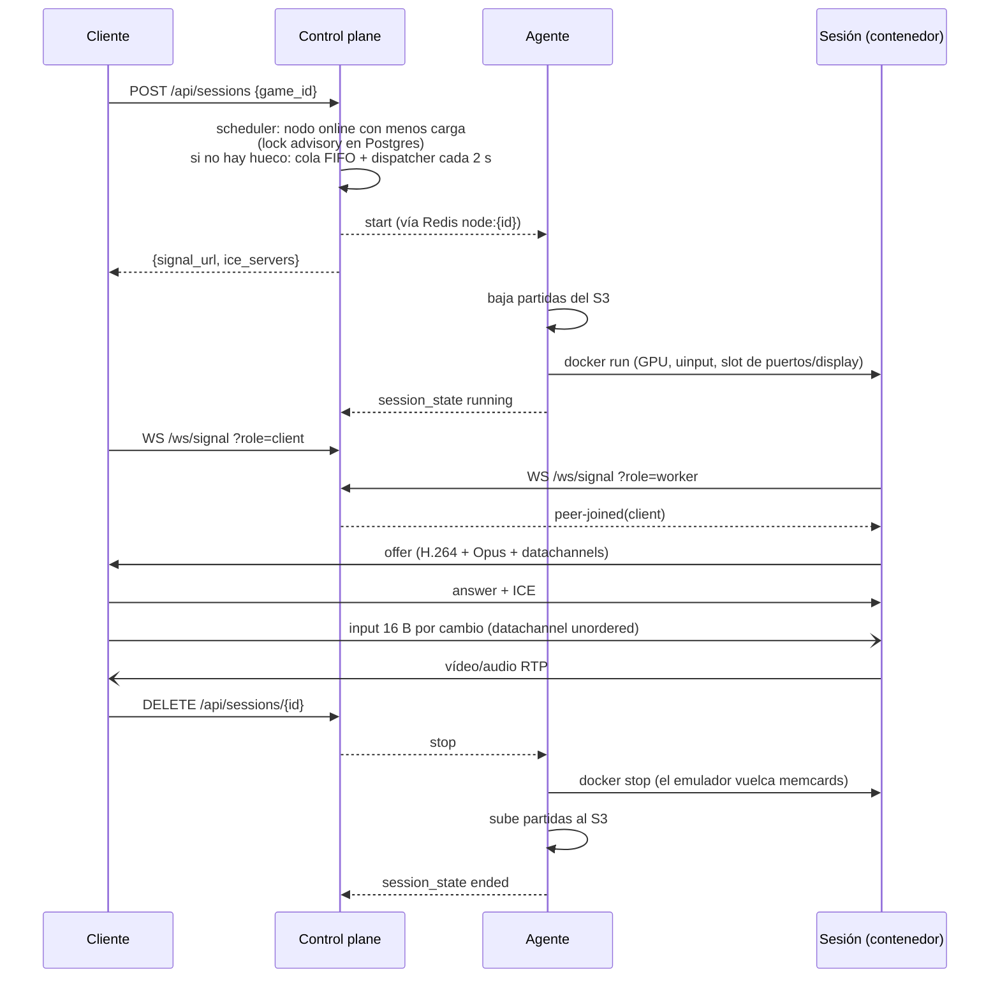

# Arquitectura

## Flujo de una partida

## Decisiones

**WebRTC con el worker como offerer.** Mínima latencia (UDP, sin buffer de reproducción), NAT
traversal estándar y decodificación por hardware gratis en navegadores, Android y teles. El worker
ofrece `sendonly` para que el cliente solo tenga que contestar.

**Un contenedor por sesión.** Aislamiento entre usuarios, límites de CPU/RAM por sesión, y limpieza
trivial (el contenedor muere y no deja rastro). El agente es lo único que habla con Docker.

**`network_mode: host` en las sesiones.** WebRTC sin el NAT de Docker (menos latencia y sin
romper ICE). Cada slot recibe su propio rango de puertos ICE (`ICE_PORT_BASE + slot*20`) y su display
X (`:100+slot`), y Xvfb arranca sin socket abstracto para no colisionar entre sesiones.

**Input como estado, no eventos.** Por un canal sin orden ni retransmisiones: un paquete perdido no
añade latencia ni deja botones pegados.

**Mando virtual Xbox 360 vía uinput.** SDL2 (que usan PCSX2 y Dolphin) lo reconoce sin
configuración. Sin udev dentro del contenedor, `session.py` crea el nodo `/dev/input/eventN` con
mknod como root y después baja a uid 1000 **antes** de abrir red o lanzar el emulador.

**VirtualGL con backend EGL.** OpenGL acelerado por la GPU dentro de Xvfb sin servidor X real ni
monitor. Por eso los perfiles usan el renderer OpenGL de PCSX2 y Dolphin.

**Device code para teles.** Escribir contraseñas con el mando de la tele es un infierno: la tele
muestra un código y lo apruebas desde el móvil en `/#/link`.

**Pipeline nuevo por cada cliente.** El emulador sigue corriendo; reconectar o cambiar de dispositivo
solo reconstruye el pipeline de GStreamer y renegocia.

**Cola en lugar de "vuelve más tarde".** Si no hay hueco, la partida espera en una cola FIFO por
plataforma; un dispatcher (una sola réplica a la vez, lock en Redis) la coloca en cuanto un nodo
queda libre y avisa al cliente de su posición por la señalización.

**Animación con fallback.** El cliente web usa Motion (motion.dev) para la UI y GSAP + MorphSVG para
las siluetas de la pantalla de arranque. Ambas se sirven en local (las apps de TV no dependen de un
CDN), Motion se compila a Chrome 68 y, si alguna no carga o el usuario pide menos movimiento, la
interfaz funciona igual sin animar.

## Seguridad

- Contenedores de sesión: `cap_drop: ALL` + solo `CHOWN, DAC_OVERRIDE, FOWNER, SETUID, SETGID, MKNOD`,
  `no-new-privileges`, límites de memoria/CPU/PIDs, ROMs y BIOS montados de solo lectura.
- `session.py` baja a uid 1000 antes de tocar la red; el emulador nunca corre como root.
- Tokens: JWT para usuarios, token por nodo (`id.secret`, guardado como SHA-256), token por sesión
  para el worker, TURN con credenciales efímeras HMAC (caducan a las 6 h).
- coturn bloquea relays hacia redes privadas salvo la subred de workers que permitas.

### Límites conocidos

- La regla de cgroup `c 13:* rmw` permite a un contenedor abrir *cualquier* nodo de input si lo crea
  con mknod. El riesgo práctico es bajo (solo corre el emulador, sin root), pero si necesitas
  aislamiento duro, sustituye uinput por un interposer `LD_PRELOAD` de joystick como hace Selkies.
- `network_mode: host` comparte la red del nodo con las sesiones: dedica las máquinas worker solo a esto.
- Esquema de BD con `create_all` (sin migraciones). Antes de producción, mete Alembic.
